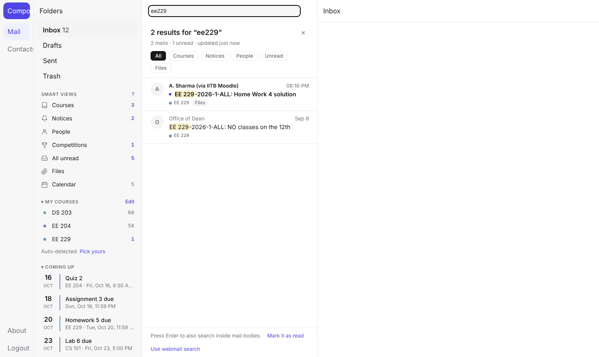
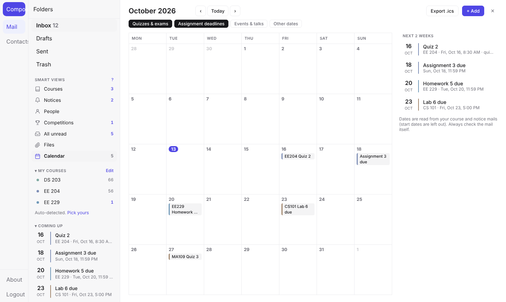
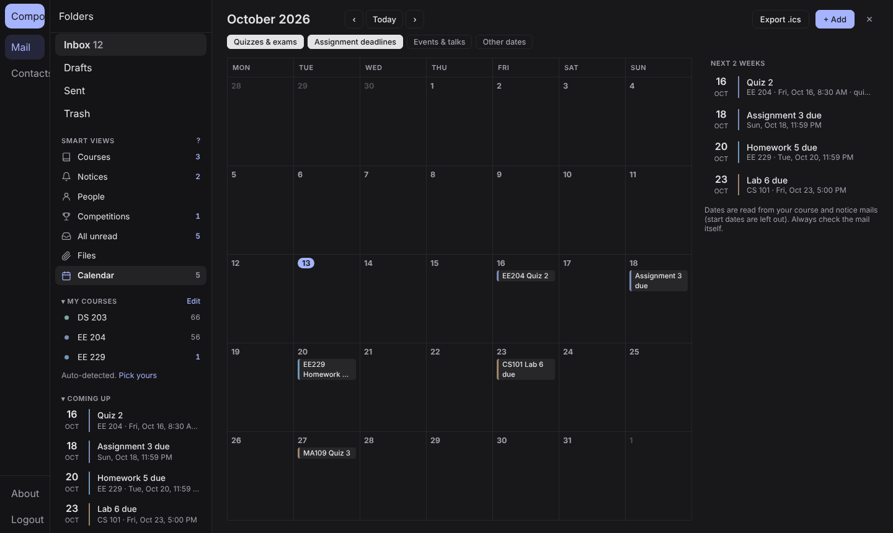
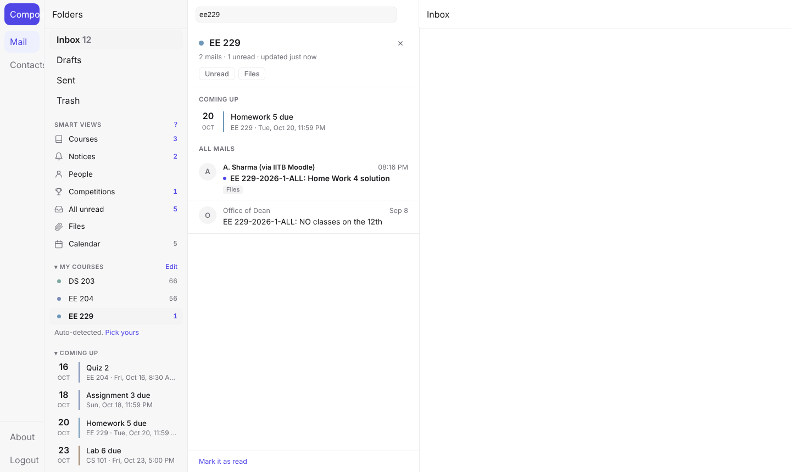
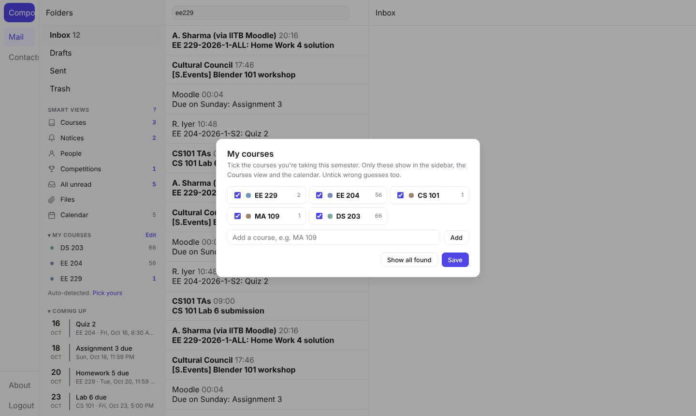

<h1 align="center">IITB Webmail+</h1>

A Chrome extension that makes <a href="https://webmail.iitb.ac.in">webmail.iitb.ac.in</a> fast and pleasant to use: 
instant search, your courses, a deadline calendar and a clean minimal look.

## Why

The webmail's built-in search is slow, misses mails, and stops working for some accounts after an
address change (for example roll-number id to name id). Course mails, notices and deadlines all land
in one long list. Webmail+ fixes that from inside the page you already use. No new app, no password.

## Features

- **Instant search as you type.** `EE229` also finds `EE 229` and `EE-229`. Searches every received
  mail, not just the current page. Press **Enter** to also look inside mail bodies.
  Filters: `from:` `subject:` `course:` `is:unread` `has:attachment` `in:` `after:2026-09-01`
  `before:` `newer:7d` `older:1m`.
- **Smart views** in the sidebar: Courses, Notices, People, Competitions, All unread, Files, Calendar.
- **My courses.** Detected from Moodle and course mails. Click **Edit** to tick the courses you're
  taking this semester or add a missing code. Each course gets its own view with unread count.
- **Calendar** of quizzes, exams and assignment deadlines read from your course mails (start dates
  are left out). You decide what shows, can hide wrong entries, add your own, and export to
  Google / Apple Calendar (`.ics`).
- **Competitions**: hackathons, challenges, contests and case comps in one place, without seminars
  and talks.
- **Files finder**: every mail with an attachment, grouped by course, with direct downloads.
- **Mute mailing lists** like `[S.Events]` so they stop cluttering the Inbox (nothing is deleted).
- **Mark a whole view as read**, and keyboard shortcuts (press `?`).
- **Minimal theme** for the whole webmail with light and dark mode. Untick "Webmail+ look" in the
  sidebar to get the stock design back.

<table>
<tr><td></td><td></td></tr>
<tr><td></td><td></td></tr>
</table>

## Install (2 minutes)

1. Click the green **Code** button on this page, then **Download ZIP**, and unzip it somewhere you'll keep it.
2. Open `chrome://extensions` (works in Chrome, Brave, Edge and Arc).
3. Turn on **Developer mode** (top right).
4. Click **Load unpacked** and pick the unzipped folder (the one containing `manifest.json`).
5. Open or reload [webmail.iitb.ac.in](https://webmail.iitb.ac.in). The first time, it takes a minute
   to read your mail list in the background; search works while it fills in.

**Updating:** download the new ZIP, replace the folder's contents, click the reload icon on
IITB Webmail+ in `chrome://extensions`, then reload webmail.

## Keyboard shortcuts

| Keys | Action |
| --- | --- |
| `/` | Jump to search |
| `j` `k` or `↓` `↑`, `Enter` | Move through results, open |
| `g` then `u` / `c` / `n` / `p` / `x` | Unread, Courses, Notices, People, Competitions |
| `g` then `d` / `a` | Calendar, Files |
| `Esc` | Close the panel |
| `?` | Help |

## Privacy

- Runs only on `webmail.iitb.ac.in` and uses the session you are already logged in with. It never
  asks for or sees your password or SSO token.
- Your mail list (subjects, senders, dates) is kept in your own browser's local storage, per account.
- Nothing is sent anywhere else: no server, no analytics, no third-party requests.
- Mail bodies are read only for recent course and notice mails (to find dates), using the webmail's
  "view source", which does not mark mail as read.

## How it works

Roundcube (the software behind IITB webmail) loads the message list over a small JSON API. The
extension calls the same API in the background, page by page, to build a local index of your
received mail (Sent, Drafts, Trash and Junk are skipped), then searches and groups that index
instantly. Dates for the calendar are parsed from subjects and recent mail bodies. The look is plain
CSS on top of Roundcube's Elastic skin.

| File | What it does |
| --- | --- |
| `manifest.json` | Chrome extension manifest (MV3) |
| `content.js` | Search, index, sidebar, calendar, course picker |
| `theme.css` + `early.js` | The minimal theme, applied before the page paints |

## Contributing

Issues and pull requests are welcome, especially better date parsing for course mails and support
for other browsers. Dates are read from free text, so always check the original mail before a
deadline.

## License

[MIT](LICENSE) © 2026 Pranav Jaju. Not affiliated with IIT Bombay.
